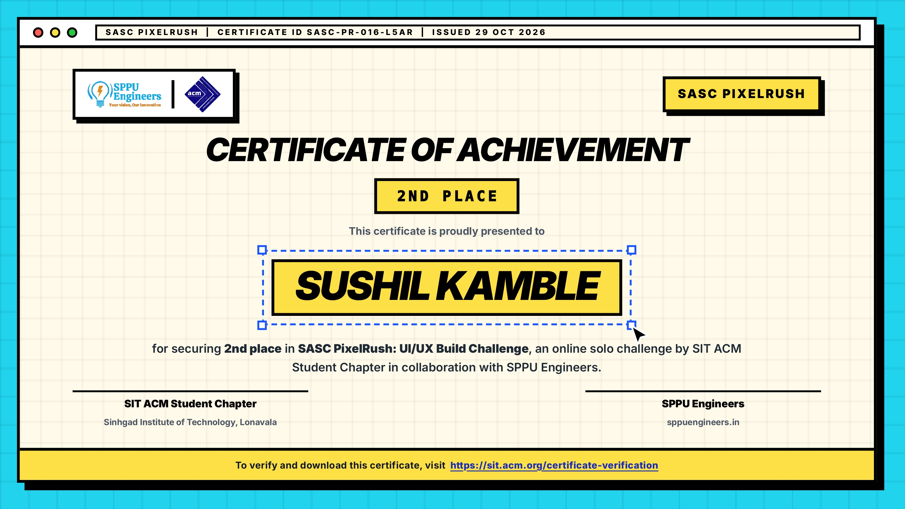
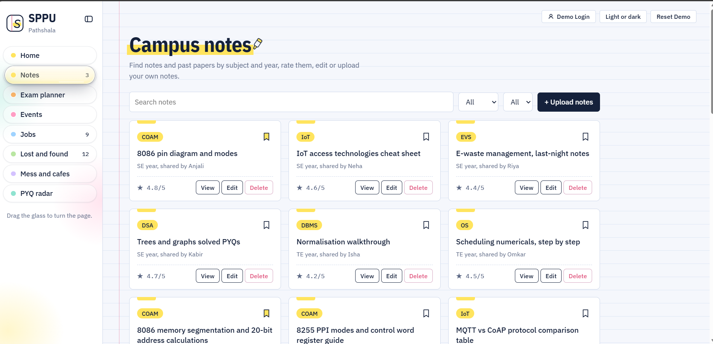
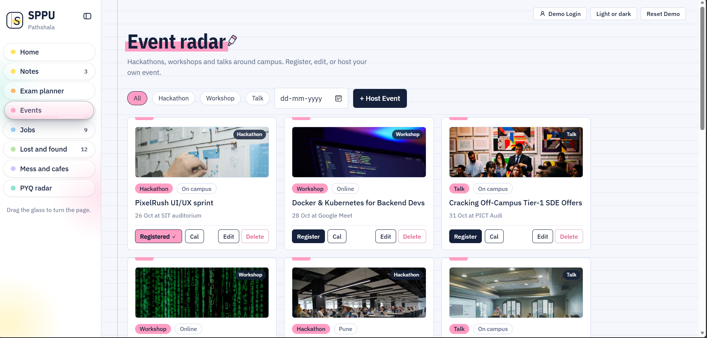
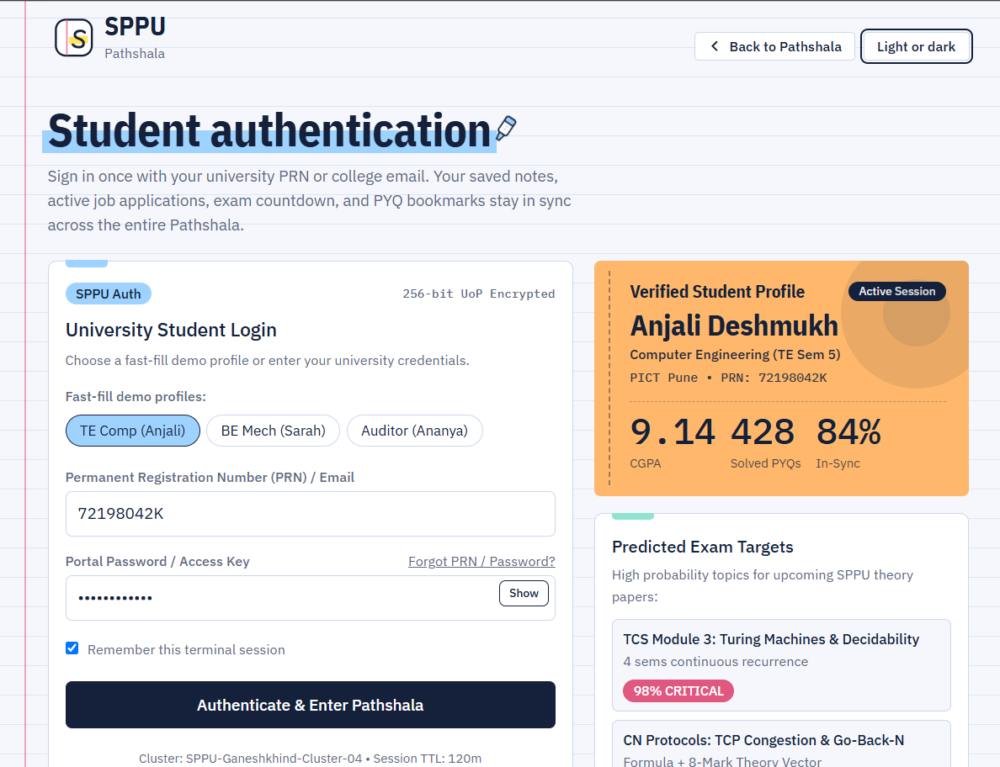

# 📚 SPPU Pathshala

<div align="center">


<br/>


<br/>


<br/>

[](https://sppu-pathshala.vercel.app/)
[](https://sitacm.vercel.app/events/sasc-pixelrush-the-6-day-uiux-build-sprint)

</div>

---

## ✨ About the Project

**SPPU Pathshala** is a student-focused web project developed for **SASC PixelRush — The 6-Day UI/UX Build Sprint**.

Designed around the academic needs of students at Savitribai Phule Pune University (SPPU), the project aims to provide a convenient and intuitive digital experience for discovering academic resources.

The vision is simple: **less time searching, more time learning.**

## 🎯 The Vision

- 🎓 Make academic resources easier to discover.
- 🧭 Create an intuitive and student-friendly browsing experience.
- 📱 Prioritize usability across desktop and mobile screens.
- 🎨 Explore thoughtful UI/UX design through a practical build sprint.

## 🛠️ Tech Stack

- **Frontend:** HTML , CSS , JS
- **Deployment:** Vercel
- **Version Control:** Git and GitHub


## 📸 Screenshots

<div align="center">

### Certificate of Achivement 2nd Place in SASC PixelRush


### Notes Section


<br/>

### Events Page


<br/>

### Login Page


</div>

## 🌐 Explore the Project

<div align="center">

<a href="https://sppu-pathshala.vercel.app/">
  
</a>

<br/><br/>

**Built as part of SASC PixelRush**

*Six days. One idea. A better student experience.*

</div>

## 🚀 Run Locally

```bash
git clone <your-repository-url>
cd <your-project-folder>
```

Install the project's dependencies and follow its setup instructions.

## 🔮 Future Scope

- Expand academic resource coverage.
- Add subject-wise and semester-wise discovery.
- Improve search and filtering.
- Introduce additional student productivity features.
- Continue refining accessibility and responsive interactions.

## 👨‍💻 Author

**Sushil Kamble**

[](https://github.com/sushil3050-ctrl)
[](https://www.linkedin.com/in/getsushilkamble/)
[](https://sushilrk.vercel.app/)

---

<div align="center">


**Made with ❤️ for the SPPU student community**

<sub>Created for SASC PixelRush · The 6-Day UI/UX Build Sprint</sub>

</div>
